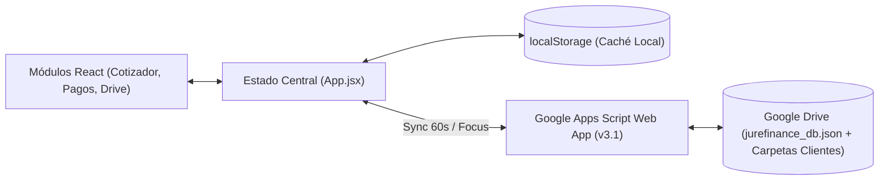

# Guía de Uso y Funcionamiento — JureFinance (JureTravel)

## 1. Idea General y Propósito del Proyecto

**JureFinance** es la aplicación web de gestión operativa, financiera y documental diseñada a medida para la agencia de viajes **JureTravel**.

Su objetivo principal es **centralizar los números reales de la agencia** en un único entorno digital, cubriendo de punta a punta el circuito operativo diario: **cotización y arbitraje de proveedores → venta al pasajero → reserva y emisión de aéreos → liquidación por bloques (BCP) y pago a operadores mayoristas (TTOO) → cobranzas y expedientes digitales en Google Drive**.

> **Concepto clave de negocio:** El presupuesto comercial que recibe el viajero (PDF con markup incluido) se genera fuera de la aplicación con la herramienta del proveedor mayorista. **JureFinance actúa como el libro mayor interno de la agencia**, donde se registra cuánto paga realmente el cliente (`precioVenta`) frente a cuánto le cuesta realmente a la agencia cada servicio (`costo` de la oferta de compra elegida), permitiendo vender con el presupuesto de un proveedor y comprar el servicio a otro más económico o bonificado.

### ¿Para qué sirve?
1. **Registrar cotizaciones y calcular la ganancia real por servicio:** Permite comparar ofertas de múltiples operadores mayoristas (Aero, PriceTravel, Azabache, etc.) para un mismo servicio, elegir con cuál se compra efectivamente y obtener el margen real neto ($\text{Ganancia} = \sum \text{Precio de Venta} - \sum \text{Costo de Compra}$).
2. **Controlar el ciclo de emisión de aéreos:** Lleva la trazabilidad de cada vuelo (`SinReservar` → `Reservado` → `Emitido`) y calcula automáticamente cuándo vence el pago al operador según la fecha de emisión.
3. **Automatizar los bloques de pago (BCP) por proveedor:** Modela la operatoria real de consolidadores como **AERO**, donde los boletos emitidos dentro de un rango de días (p. ej., del 1 al 5 del mes) se acumulan en una "caja" y se liquidan todos juntos en una fecha de pago determinada (p. ej., el día 20).
4. **Gestionar Cuentas a Pagar y Flujo de Caja Auditable:** Agrupa obligaciones individuales y liquidaciones consolidadas por proveedor, fecha de vencimiento y moneda (`USD` / `ARS`), permitiendo registrar pagos parciales, individuales o en bloque (reparto automático **FIFO**) y exportar el reporte mensual a **CSV**.
5. **Seguir Cuentas a Cobrar y Métricas (Dashboard):** Organiza los cobros a clientes por mes y presenta indicadores ejecutivos de rentabilidad, ventas cerradas y alertas de vencimientos próximos.
6. **Sincronizar Expedientes y Base de Datos con Google Drive:** Conecta en tiempo real la aplicación con las carpetas de clientes en Google Drive (vouchers, pasajes, DNI/pasaportes) y respalda toda la base operativa mediante un conector propio en **Google Apps Script (v3.1)**.

---

## 2. Arquitectura y Stack Tecnológico

La aplicación está construida como una **Single Page Application (SPA)** con persistencia híbrida (**Local-First + Sincronización Bidireccional con Google Drive** via Google Apps Script).

| Capa | Tecnología | Propósito |
| :--- | :--- | :--- |
| **Frontend UI** | React 19 + Vite 8 | Interfaz reactiva modular con estado centralizado en `src/App.jsx`. |
| **Estilos y Diseño** | CSS Variables nativas + Lucide React | Sistema de diseño limpio, adaptable y con iconografía semántica. |
| **Lógica de Negocio** | Servicios ES Modules (`src/services/`) | Motores puros de cálculo para servicios, bloques TTOO, liquidaciones FIFO y flujo de caja. |
| **Persistencia Local** | `localStorage` | Caché inmediata en el navegador para operación sin latencia. |
| **Backend / Cloud Sync** | Google Apps Script Web App (`v3.1`) | Conector serverless (`google-apps-script/Code.gs`) que sincroniza la base `jurefinance_db.json` y el árbol precalculado `jurefinance_tree.json` en Google Drive. |
| **Calidad y Testing** | Vite SSR + Node + Oxlint | Suite de pruebas del modelo matemático (`test:modelo`), renderizado de vistas (`test:ui`) y smoke test en navegador real (`test:runtime`). |



---

## 3. Circuito Operativo de la Agencia

El flujo de trabajo diario dentro de **JureFinance** sigue 6 etapas principales:

1. **Configuración de Proveedores y Calendario Mensual (BCP):**
   - Se dan de alta los operadores mayoristas (**Aero**, **Price**, **Azabache**, etc.).
   - En **Configuración Mensual**, se definen para cada proveedor y mes los bloques de días de emisión y su fecha de pago asociada (manualmente, con plantilla estándar, por regla automática o copiando del mes anterior).
2. **Carga de la Cotización (Wizard de 3 pasos):**
   - **Paso 1 (Datos del viaje):** Se ingresa el cliente titular, nombres de pasajeros (`pasajeros[]`), destino, fechas del viaje, cantidad de PAX, moneda (`USD` o `ARS`) y se tildan los proveedores con los que se cotiza.
   - **Paso 2 (Servicios y costos):** Por cada servicio (Aéreo, Alojamiento, Traslado, Asistencia, etc.) se carga el **precio de venta total** informado al cliente y una o varias **ofertas de compra** de distintos proveedores. Se marca con el selector **"Comprar"** cuál es la oferta ganadora.
   - **Paso 3 (Resumen y Guardado):** El sistema calcula automáticamente el total de venta, el costo real, la ganancia neta y el margen porcentual, habilitando una vista de **Resumen Interno Imprimible**.
3. **Seguimiento Comercial (Estados de Cotización):**
   - La cotización avanza por los estados: `Borrador` → `Enviada` → `Aceptada` → `Pagada` (o `Vencida`).
4. **Reserva y Emisión de Aéreos:**
   - En los servicios de tipo aéreo se controla el estado del boleto: `SinReservar` → `Reservado` (con fecha de reserva) → `Emitido` (con `fechaEmision`).
   - Al marcar un vuelo como **Emitido**, si la oferta no tenía una fecha de vencimiento manual, el sistema consulta la **Configuración Mensual** del proveedor de compra y asigna automáticamente la fecha de pago correspondiente al bloque en que cayó la emisión.
5. **Liquidación y Pago a Proveedores (Cuentas a Pagar):**
   - Todas las ofertas de compra con costo mayor a `0` generan obligaciones en el calendario.
   - En la vista de **Liquidación por proveedor / Flujo de Caja BCP**, los boletos emitidos en un mismo bloque aparecen consolidados bajo una única fecha de vencimiento.
   - La agencia puede pagar un ticket individual o registrar un **pago consolidado del bloque**, que el sistema reparte automáticamente en orden **FIFO** (primero el más antiguo) entre los servicios que componen esa liquidación.
6. **Cobranza al Cliente y Expediente en Drive:**
   - Se monitorean los cobros mensuales derivados de las ventas y se archivan en la carpeta de Google Drive del cliente los vouchers, pasajes emitidos y copias de DNI/pasaportes.

---

## 4. Guía de Uso por Módulo

### 4.1. Cotizador (`src/components/Cotizador/`)
Es el corazón operativo para presupuestar y registrar ventas.
- **Wizard en 3 pasos (`CotizadorWizard.jsx`):**
  1. **Datos del Viaje:** Cliente, contacto, destino, fechas, cantidad de pasajeros, lista nominal de pasajeros y selección de operadores participantes.
  2. **Servicios y Costos:** Permite agregar múltiples renglones de servicios (`Aéreo`, `Hotel`, `Traslado`, `Asistencia`, `Excursión`, `Crucero`, `Otro`).
     - En cada servicio se carga el `precioVenta` (importe total que abona el cliente por todos los pasajeros) y las `ofertas[]` de los proveedores.
     - Permite comparar precios entre proveedores y seleccionar la **oferta de compra** (`ofertaCompraId`). Si un servicio es bonificado (costo `0`), suma a la ganancia sin generar deuda con el proveedor.
     - Para servicios **Aéreos**, despliega los campos de itinerario (ruta, aerolínea, fechas) y estado del boleto (`SinReservar`, `Reservado`, `Emitido`).
  3. **Resumen y Guardado:** Muestra el desglose financiero final, permite cambiar el estado comercial de la operación y abrir el modal **Resumen Interno** listo para imprimir o guardar en PDF.

### 4.2. Historial de Cotizaciones (`src/components/Historial/HistorialView.jsx`)
- Listado completo de todas las cotizaciones registradas con buscador por cliente, destino o ID y filtros por estado (`Borrador`, `Enviada`, `Aceptada`, `Pagada`, `Vencida`).
- Acciones rápidas por fila: **Editar** (abre la cotización en el Cotizador), **Duplicar** (crea una copia en estado `Borrador`), **Abrir Carpeta en Drive** y **Eliminar**.

### 4.3. Configuración Mensual BCP (`src/components/Configuracion/ConfiguracionMensualView.jsx`)
Administra las reglas de calendario ("día de emisión → fecha de pago") por operador y por mes (`YYYY-MM`):
- **Edición manual de bloques:** Define rangos `DiaInicio` – `DiaFin` y su `FechaPago` (con vista previa automática del rango en formato `DD/MM/YYYY`).
- **Generador por regla automática:** Crea bloques de $N$ días de duración y asigna el vencimiento sumando días corridos o fijando un día posterior al cierre del bloque.
- **Plantilla estándar y Copia entre meses:** Permite aplicar en un clic la estructura habitual de bloques o clonar la configuración de otro mes adaptando automáticamente la cantidad de días del mes (28, 29, 30 o 31 días).
- **Indicador de cobertura:** Valida visualmente si todos los días del mes están cubiertos sin huecos ni solapamientos.

### 4.4. Cuentas a Pagar a Proveedores (`src/components/Cobranzas/CalendarioPagosView.jsx` y `FlujoCajaBCP.jsx`)
Gestiona el pasivo con los operadores mayoristas mediante tres herramientas integradas:
1. **Calendario Mensual de Vencimientos:** Grilla visual día por día con semáforo de estados (`Pendiente`, `Parcial`, `Pagado`, `Vencido`), filtros por proveedor y alta de compromisos manuales.
2. **Liquidación por Proveedor (Pago en Bloque):** Agrupa todas las obligaciones que comparten `proveedor + fecha de vencimiento + moneda`. Permite abonar el total o un monto parcial del bloque completo; el algoritmo `repartirPagoEnLiquidacion` distribuye el dinero secuencialmente (**FIFO**) entre los vuelos/servicios del bloque.
3. **Reporte de Flujo de Caja Auditable (`FlujoCajaBCP`):**
   - Muestra el total general del mes separado estrictamente por moneda (`USD` y `ARS` nunca se mezclan).
   - Desglosa por cada fecha de vencimiento y proveedor todos los tickets incluidos: cliente titular, nombres de pasajeros, PAX, código de cotización, destino, fecha de emisión y bloque BCP aplicado.
   - Incluye botón de **Exportación a CSV** compatible con Excel y botón para cargar **10 vuelos de demostración** para pruebas operativas.

### 4.5. Cuentas a Cobrar (`src/components/Cobranzas/CalendarioCobrosView.jsx`)
- Proyecta los ingresos de la agencia derivados del `precioVenta` de las cotizaciones activas, organizados por mes y estado de cobro.

### 4.6. Directorio de Operadores (`src/components/Operadores/OperadoresView.jsx`)
- Catálogo de proveedores mayoristas (nombre, especialidad, contacto, comisión de referencia y notas).
- Cualquier proveedor dado de alta aquí queda disponible inmediatamente en el **Paso 1 del Cotizador** y en la **Configuración Mensual BCP**.

### 4.7. Dashboard Ejecutivo (`src/components/Dashboard/DashboardView.jsx`)
- Panel de métricas clave (KPIs): volumen total de ventas, costo neto de operadores, ganancia real acumulada, margen promedio y alertas tempranas de vencimientos urgentes (próximos 3 días o vencidos).

### 4.8. Expedientes en Google Drive (`src/components/DriveViewer/DriveView.jsx` y `DriveConfigModal.jsx`)
- Explorador integrado de las carpetas de clientes alojadas en Google Drive.
- Permite navegar subcarpetas, previsualizar/abrir documentos (vouchers, tickets aéreos, pasaportes), subir nuevos archivos directamente desde la interfaz y configurar la URL del conector de **Google Apps Script v3.1**.

---

## 5. Modelo Matemático y Reglas de Negocio Clave

| Concepto | Regla en el Sistema |
| :--- | :--- |
| **Importes por Servicio** | Tanto `precioVenta` como el `costo` de cada oferta representan el **total del servicio para todo el grupo de pasajeros (PAX)**, nunca un valor unitario por pasajero. El valor por pasajero se exhibe únicamente como referencia informativa. |
| **Ganancia Real** | $\text{Ganancia} = \sum \text{precioVenta} - \sum \text{costo}(\text{ofertaCompra})$. Las ofertas alternativas quedan guardadas como referencia comparativa pero no afectan ni la ganancia ni los pagos. |
| **Servicios Bonificados** | Si la oferta de compra seleccionada tiene `costo = 0`, el servicio suma su `precioVenta` a la ganancia pero **no genera obligación de pago** en el calendario. |
| **Overlay de Pagos (`pagosTTOO`)** | Los pagos realizados **no mutan la cotización**: se almacenan en una colección separada y se cruzan en tiempo real mediante la clave `${cotizacionId}::${itemId}` (manteniendo compatibilidad automática con claves históricas mediante `clavesAlias`). |
| **Separación Estricta de Monedas** | Los cálculos de liquidaciones y totales mensuales de flujo de caja agrupan siempre por moneda (`USD` / `ARS`), evitando sumar divisas distintas. |

---

## 6. Estructura del Proyecto

```text
JureFinance/
├── docs/
│   ├── FLUJO_CLIENTE.md           # Especificación detallada del circuito operativo de JureTravel
│   └── CONTEXTO_Y_ESTADO.md       # Estado técnico, decisiones de arquitectura y roadmap
├── google-apps-script/
│   ├── Code.gs                    # Código fuente del conector Web App v3.1 para Google Drive
│   └── DESPLIEGUE_v3.1.md         # Guía paso a paso para publicar el conector en Apps Script
├── scripts/
│   ├── probarModelo.mjs           # Suite de 65 asertos sobre servicios, bloques BCP y pagos FIFO
│   ├── probarUI.mjs               # Pruebas de renderizado SSR de las vistas financieras
│   └── probarRuntime.mjs          # Smoke test automatizado en navegador headless
├── src/
│   ├── components/
│   │   ├── Calendario/            # Grilla mensual reutilizable
│   │   ├── Cobranzas/             # CalendarioPagosView, CalendarioCobrosView y FlujoCajaBCP
│   │   ├── Configuracion/         # ConfiguracionMensualView (BCP) y DriveConfigModal
│   │   ├── Cotizador/             # CotizadorView, QuotePreviewModal y Wizard de 3 pasos
│   │   ├── Dashboard/             # DashboardView (KPIs y métricas de ganancia)
│   │   ├── DriveViewer/           # Explorador de expedientes en Google Drive
│   │   ├── Historial/             # HistorialView (gestión de cotizaciones guardadas)
│   │   ├── Operadores/            # OperadoresView (ABM de proveedores TTOO)
│   │   ├── Header.jsx             # Barra superior con alertas y botón de sincronización Drive
│   │   └── Sidebar.jsx            # Navegación lateral con contadores de vencimientos
│   ├── data/
│   │   ├── initialData.js         # Semilla inicial de operadores, cotizaciones y bloques BCP
│   │   └── demoVuelos.js          # Generador de 10 vuelos emitidos de prueba
│   ├── services/
│   │   ├── serviciosService.js    # Normalización de servicios, ofertas de compra y márgenes
│   │   ├── ttoService.js          # Motor de bloques BCP, cobertura mensual y fechas de pago
│   │   ├── calendarioService.js   # Agenda de obligaciones, liquidaciones FIFO y exportación CSV
│   │   ├── cobroService.js        # Proyección de cobranzas a pasajeros
│   │   └── driveService.js        # Sincronización bidireccional con Google Drive y caché local
│   ├── App.jsx                    # Controlador principal de estado y sincronización
│   └── main.jsx                   # Punto de entrada React
├── GUIA_DE_USO_Y_FUNCIONAMIENTO.md # Esta guía general de uso y funcionamiento
├── README.md                      # Resumen rápido del repositorio
└── package.json                   # Dependencias y scripts de ejecución
```

---

## 7. Instalación, Uso y Verificación

### 7.1. Requisitos Previos
- **Node.js** 20 o superior.
- **npm** (incluido con Node.js).

### 7.2. Comandos Principales

```bash
# 1. Instalar dependencias
npm install

# 2. Iniciar servidor de desarrollo (http://localhost:5173)
npm run dev

# 3. Ejecutar pruebas del modelo de negocio y agenda de pagos (65 validaciones)
npm run test:modelo

# 4. Ejecutar pruebas de renderizado de interfaz (SSR)
npm run test:ui

# 5. Ejecutar linter de código
npm run lint

# 6. Compilar versión de producción (carpeta dist/)
npm run build
```

### 7.3. Conexión con Google Drive (Opcional en local, requerido en producción)
1. Abrir el módulo **Expedientes Drive** en el menú lateral y pulsar en **Configurar Drive**.
2. Copiar el código del conector **v3.1** (o tomarlo de `google-apps-script/Code.gs`) y publicarlo como **Aplicación Web** en <https://script.google.com> siguiendo los pasos de `google-apps-script/DESPLIEGUE_v3.1.md`.
3. Pegar la URL `/exec` generada y el ID de la carpeta raíz de Google Drive en el modal de configuración.
4. A partir de ese momento, **JureFinance** sincronizará automáticamente cada 60 segundos y al recuperar el foco de la ventana.
